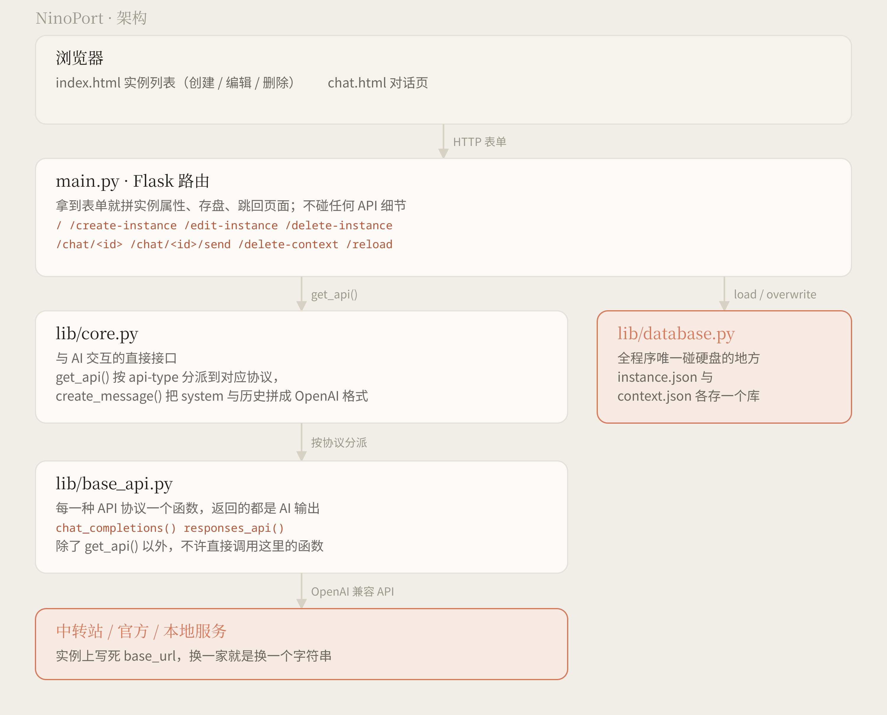

# NinoPort 🪐

NinoPort 是一个跑在自己电脑上的小面板，用来管那些散在各处的 AI 接口。

一个「实例」就是一套 API Key ＋ 模型 ＋ 几个开关的组合。填好之后，它会得到一个随机编号，点开就能直接对话——不用每次都去翻是哪家中转站、该填哪个模型名、那条 `curl` 又该怎么写。

所有配置和历史都只存在本机的几个 JSON 文件里，不上传、不联网（除了你让它去调的那家 API）。

> 官网在 https://pinpe.github.io/ninoport/ ，结构说明也能在这儿看到。

---

## ✨ 它做了什么

- **多协议**：一个实例可以选择走 `Chat Completions` 还是 `OpenAI Responses API`，两边的差异在 `lib/base_api.py` 里消化掉了，上层不用管
- **思考开关与思考强度**：`thinking` 与 `reasoning_effort` 分开做成了两个参数，因为不同协议的表达方式不一样
- **等效代码**：创建 / 编辑实例时，右边会实时生成这个实例将来实际发出的那段 OpenAI 调用代码。填错了能当场看出来，想抄走也随手
- **系统提示词**：留空就完全不发 system 消息，不塞空字符串
- **保存上下文**：关掉之后每轮只发当前这一条，历史照样记着、只是不进请求
- **对话页**：AI 的回复按 markdown 渲染（marked 解析 + DOMPurify 消毒），报错的那条会单独标出来，原样显示不渲染
- **清空上下文**：实例留着，聊过的都清掉

## 🗺️ 架构



一共三层，边界划得比较死：

1. **`main.py`** —— 只管 Flask 那点事：收表单、拼配置、存盘、跳页面。它不碰任何 API 细节。
2. **`lib/core.py`** —— 与 AI 交互的直接接口。`get_api()` 按 `api-type` 分派到对应协议，`create_message()` 把系统提示词和历史拼成 OpenAI 标准格式。
3. **`lib/base_api.py`** —— 每种协议一个函数。外面只许通过 `get_api()` 进来，不要在别处直接调它。

另外单独一格：**`lib/database.py`**，全程序唯一碰硬盘的地方。换个程序也能原样拿走的那部分叫 `lib`，它是唯一一个破例的——但它管的是「边界」，所以单独放着。

## 🚀 跑起来

需要 **Python 3.11 或更高版本**（用到了 `typing.Unpack`）。

```bash
git clone https://github.com/Pinpe/ninoport.git
cd ninoport
pip install -r requirements.txt
python main.py
```

然后打开 <http://127.0.0.1:5000>，点「创建实例」。

要填的东西：

- **API 协议**：一般选 Chat Completions；走官方新接口的选 Responses
- **API Key**：只存在你本机的 `database/instance.json` 里
- **API 端点**：中转站或者本地服务都填这儿；留空则走 OpenAI 官方端点
- **模型名称**：原样交给 API，拿不准就去服务商文档里抄一份

## 📁 目录

```
ninoport/
├─ main.py              Flask 路由，所有入口都在这里
├─ lib/
│  ├─ core.py           与 AI 交互的直接接口
│  ├─ base_api.py       各种 API 协议的实现
│  └─ database.py       唯一碰硬盘的地方
├─ templates/           index.html 实例列表 / chat.html 对话页
├─ static/              样式表与图标
├─ database/            运行后生成：instance.json、context.json
└─ readme_src/          README 用图的源码与生成脚本
```

`readme_src/` 里那两张图不是画图软件导出的，是 `make_assets.py` 生成的，改配色或改文案直接改脚本再跑一遍：

```bash
python3 readme_src/make_assets.py
```

配色和字体跟 `static/style.css` 里的 `:root` 是同一套，别两处对不上。

## 🔒 数据与隐私

`database/instance.json` 里的 API Key 是**明文**存的。这套东西是给自己本地用的，没有账号系统、没有加密、也没有权限管理——所以：

- 别把它挂到公网上
- `database/` 已经在 `.gitignore` 里了，别手滑提交上去

## 📜 许可

[GPL-3.0](LICENSE)

## 相关

- [Nino](https://github.com/Pinpe/nino-ai-chat) —— 轻量级的 AI 陪伴聊天软件
- [NinoClaw](https://github.com/Pinpe/ninoclaw) —— 住在终端里的 AI 助手
